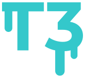
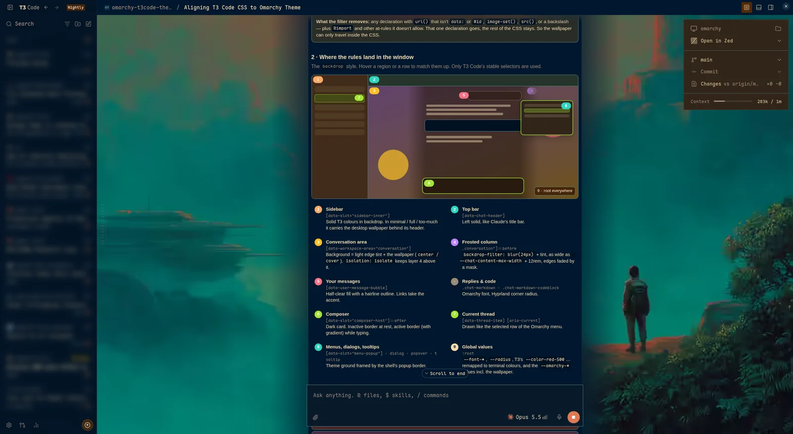
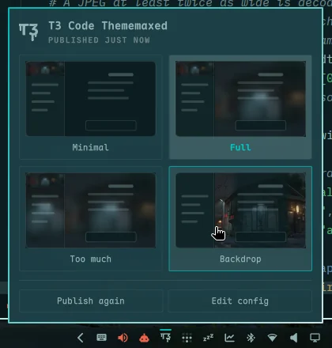
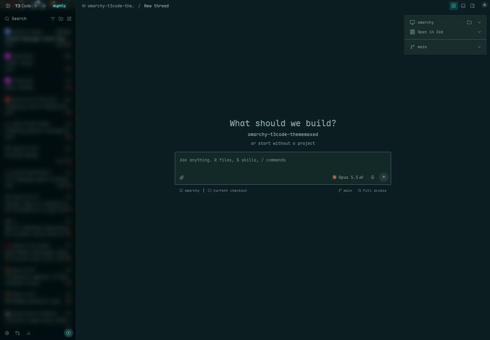
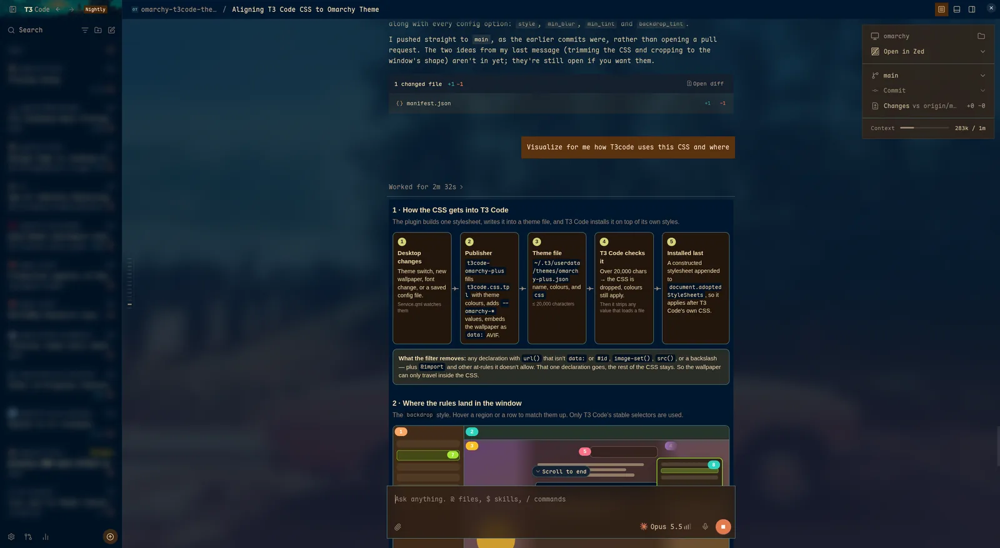
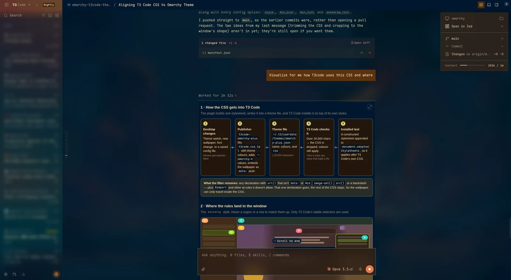

<p align="center"></p>

<h1 align="center">T3 Code Thememaxed</h1>

<p align="center">
  <a href="https://github.com/jagrat7/omarchy-t3code-thememaxed/commits/main"></a>
  <a href="https://omarchy.org/"></a>
  <a href="LICENSE"></a>
</p>

An Omarchy plugin that gives [T3 Code](https://github.com/pingdotgg/t3code) the
rest of the desktop's look, not just its colours: the system font, Hyprland's
corners and borders, the shell's menus and popups, and the theme's wallpaper
behind the app. It follows every theme switch, font change and new wallpaper
on its own.



Omarchy already publishes a colours-only T3 Code theme called **Omarchy**.
This plugin leaves that one alone and publishes a second theme, **Thememaxed**,
built on the same palette.

## Install

```bash
omarchy plugin add https://github.com/jagrat7/omarchy-t3code-thememaxed.git --enable
```

Then in T3 Code choose **Settings > Appearance > Thememaxed**. That's all: the
plugin runs in the Omarchy shell and republishes the theme whenever the
desktop changes.



The plugin also puts its icon, T3 dripping paint, in the bar. Click it for a
panel with a small preview of each style, drawn in your theme's colours with
your wallpaper where that style puts it. Click one to switch. Under
`backdrop` a slider sets the chat column's tint. The panel can also publish
again or open the config, and a middle click on the icon publishes again.

To move or remove the icon, use the bar's widget settings like any other
widget. Updated from a version without the icon? Run
`omarchy plugin enable io.github.jagrat7.omarchy-t3code-plus right` and
restart the shell with `omarchy-restart-shell`.

<br clear="right">

## Styles

The wallpaper comes in three strengths, plus a sharp alternative to `full`:

| Style | Sidebar header | Conversation | Sidebar |
| --- | --- | --- | --- |
| `minimal` | Theme's first wallpaper | Plain | Plain |
| `full` (default) | Theme's first wallpaper | Random theme wallpaper | Plain |
| `too-much` | Theme's first wallpaper | Random theme wallpaper | Theme's first wallpaper |
| `backdrop` | Plain | Desktop wallpaper, sharp, behind a frosted chat column | Plain |

<table>
  <tr>
    <td><br><code>minimal</code></td>
    <td><br><code>full</code></td>
  </tr>
  <tr>
    <td><br><code>too-much</code></td>
    <td><br><code>backdrop</code></td>
  </tr>
</table>

All four on a new thread, on the Last Call theme.

The header always shows the theme's first wallpaper, the one Omarchy starts
the theme on, so it stays the same while you cycle the desktop's. The
conversation gets a random one of the theme's wallpapers each time the theme
is republished. Every picture is blurred and tinted enough to keep text
readable, more if the theme's own blur or scrim is stronger.

A new thread has only the heading and the composer, so there `full` and
`too-much` tint the wallpaper half as much, darker in the middle, and
`backdrop` drops its frosted column to show the whole wallpaper, with a
soft tint behind the heading and composer. The row under
the composer (machine, checkout, branch) is plain text over the wallpaper in
every style.

`backdrop` is the look of Claude Code's desktop themes: the wallpaper on your
desktop, not blurred, as the scene behind the conversation, with the chat
column as frosted glass over it. The glass blurs and tints the picture behind
the messages and fades out at its edges, so the scene stays sharp at the
sides. Its tint follows the wallpaper: a dark one is left almost as it is, a
bright one is dimmed just enough to read on. Your messages are outlined rather
than filled, and the composer is a dark card.

T3 Code caps a theme's CSS at 20,000 characters and accepts pictures only
inside it, so the wallpaper is squeezed into what is left, about 10 KB. With `avifenc` installed (from `libavif`) it is a 10-bit AVIF of up
to 1920 pixels at the best quality that fits. Finding the best quality takes a few slow
encodes, so what they measured is kept for the last few wallpapers, and
publishing one of them again (after a font, tint or config change) takes a
fraction of a second. Pixel art is found by its blocks and sent at its own
size, then scaled up with hard edges: whole as lossless WebP when that fits,
otherwise as AVIF. Without `avifenc`, a smaller ImageMagick picture is used.

Pick a style in `~/.config/omarchy-t3code-plus/config.toml`. The plugin
applies the file as soon as it is saved:

```toml
style = "full"         # minimal, full, too-much or backdrop
min_blur = 20          # least blur, as a Gaussian sigma in screen pixels
min_tint = 0.75        # least opacity of the theme background over the picture
backdrop_tint = "auto" # backdrop only: tint, 0 to 1, or "auto" from the wallpaper
```

Or from the bar's panel, or from a terminal, which also deals a new random wallpaper:

```bash
~/.config/omarchy/plugins/io.github.jagrat7.omarchy-t3code-plus/bin/t3code-omarchy-plus --style too-much
~/.config/omarchy/plugins/io.github.jagrat7.omarchy-t3code-plus/bin/t3code-omarchy-plus --tint 0.4   # or auto
```

## What changes

- **Colours.** T3 Code's stock reds, greens, blues and so on become the theme's
  terminal colours, so badges, diff counts and status text stay on theme.
  Links take the accent; selections the theme's selection colours.
- **One font.** Interface, chat, composer and code use the Omarchy system font.
- **Shape.** Corners follow Hyprland's window rounding, square included.
- **Borders.** The composer is drawn like a window: inactive border at rest,
  active border (gradient and all) while you type. Menus, dialogs and
  popovers use the shell's popup border; tooltips its tooltip border.
- **Selected rows.** The current thread and the highlighted menu item look
  like the selected row in the Omarchy menu.
- **Wallpaper.** As the style says, including on a new thread.
- **Composer row.** The machine, checkout and branch under the composer are
  plain text, without a bar behind them.

## Update and remove

```bash
omarchy plugin update io.github.jagrat7.omarchy-t3code-plus
omarchy plugin remove io.github.jagrat7.omarchy-t3code-plus
```

After removing it, choose **Omarchy** in T3 Code again. The settings stay in
`~/.config/omarchy-t3code-plus/`, the last published theme in
`~/.t3/userdata/themes/omarchy-plus.json`, and the last status and the
backdrop's cache of recent wallpapers in `~/.local/state/omarchy-t3code-plus/`;
delete them if you like.

## Without the plugin

The same publisher can run from Omarchy hooks instead of the shell. Use one
or the other, not both.

```bash
git clone https://github.com/jagrat7/omarchy-t3code-thememaxed.git
bash omarchy-t3code-thememaxed/scripts/install.sh full    # or minimal, too-much, backdrop
```

This puts `t3code-omarchy-plus` in `~/.local/bin` and adds `theme-set` and
`font-set` hooks. Omarchy has no hook for a new wallpaper, so after
`omarchy theme bg next` run `t3code-omarchy-plus` yourself. Remove it with
`bash scripts/uninstall.sh`, which moves its files to
`~/.config/omarchy/backups/`.

## Requirements

- Omarchy 4 (Quattro), which publishes T3 Code's palette
  (`omarchy-theme-set-t3code`) and resolves theme colours
  (`omarchy-theme-color`).
- A T3 Code build with theme CSS support.
- Python 3.11 or newer, which Omarchy ships.
- ImageMagick with AVIF support for the wallpaper (`omarchy pkg add
  imagemagick libheif`). Without it, everything but the wallpaper applies.

Tested with Omarchy 4.5 and T3 Code 0.1.10 (nightly, November 2026).

## How it works

`Service.qml` is a `service` plugin, so one copy runs in the shell.
`BarWidget.qml` is the bar icon and `Panel.qml` its panel;
`StylePreview.qml` draws the style previews and `DripMark.qml` the icon. It runs
[`bin/t3code-omarchy-plus`](bin/t3code-omarchy-plus) when it starts and
again when `omarchy theme set` writes `theme.generation`, when `omarchy font
set` rewrites `fonts.conf`, when the wallpaper link in
`~/.local/state/omarchy/current/` changes, and when the config is saved.

The publisher:

1. reads the palette Omarchy rendered for T3 Code
   (`~/.local/state/omarchy/current/theme/t3code.json`), or the one the theme
   ships, as Omarchy's own template convention has it;
2. renders [`themed/t3code.css.tpl`](themed/t3code.css.tpl) with the theme's
   values from `omarchy-theme-color`, the resolver Omarchy's templates use, so
   `{{ accent }}`, `{{ accent_strip }}` and `{{ accent_rgb }}` work as in
   any Omarchy template;
3. adds what a template can't know as `--omarchy-*` variables: the system
   font, Hyprland's rounding, border size and blur, the shell's popup,
   tooltip and selected-row styling from `shell.toml`, and the wallpapers as
   small blurred AVIF images;
4. writes `~/.t3/userdata/themes/omarchy-plus.json`, which T3 Code watches.

### Customising

Every block of `themed/t3code.css.tpl` says what it does. Blocks between
`/* @part <name> (<styles>) */` and `/* @end */` (header, background,
sidebar, backdrop) are kept only by the styles listed in them. A plugin update replaces the template, so
keep your changes in a fork, or clone the plugin into place and edit there:
saving republishes.

### Limits

- T3 Code takes at most 20,000 characters of theme CSS, pictures included. The
  publisher shrinks the wallpapers to fit and leaves them out, then the CSS,
  rather than publish a theme T3 Code would reject.
- Syntax colours in T3 Code's file viewer and diffs can't be themed: they are
  drawn in shadow DOM with a fixed scheme that theme CSS cannot reach.
- The CSS uses T3 Code's documented `data-*` selectors. The square-corner
  rules also match Tailwind class names, which a T3 Code update may rename.
- T3 Code marks no new-thread state. The publisher spots it by the composer
  filling the conversation (its `inset-0` class) and lets the wallpaper
  through the empty timeline's placeholder (`data-timeline-loading`). If an
  update renames either, a new thread looks like any other thread.

## Development

```bash
python3 -m unittest discover -s tests -v
omarchy plugin validate .
```

Symlink a clone into the plugin directory to work on it live:

```bash
git clone https://github.com/jagrat7/omarchy-t3code-thememaxed.git
ln -s "$PWD/omarchy-t3code-thememaxed" \
  "${XDG_CONFIG_HOME:-$HOME/.config}/omarchy/plugins/io.github.jagrat7.omarchy-t3code-plus"
omarchy-shell shell rescanPlugins
omarchy plugin enable io.github.jagrat7.omarchy-t3code-plus
```

## License

[MIT](LICENSE). Not affiliated with Omarchy or T3 Code.
