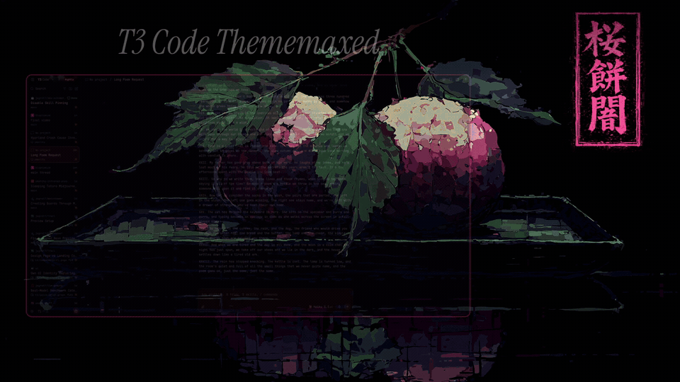
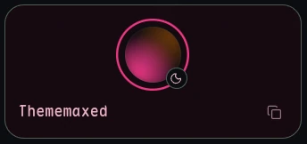
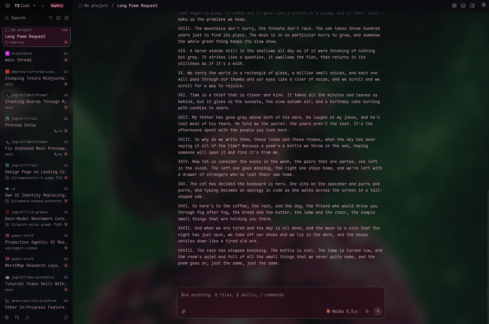
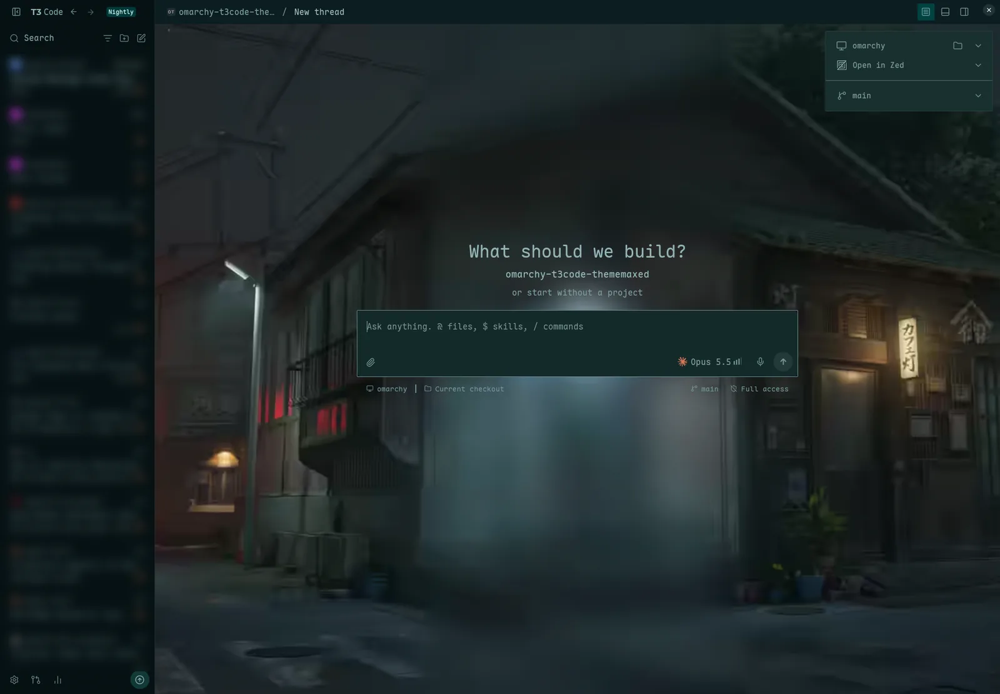
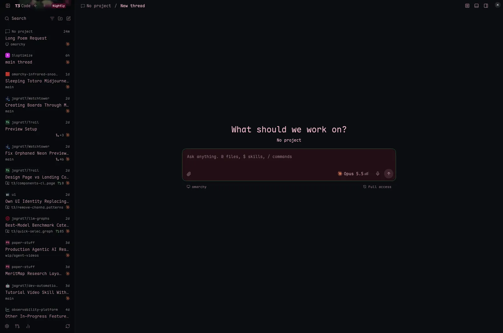
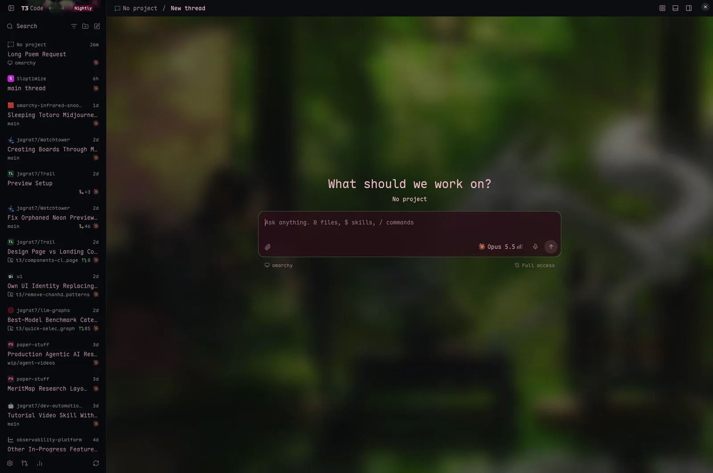
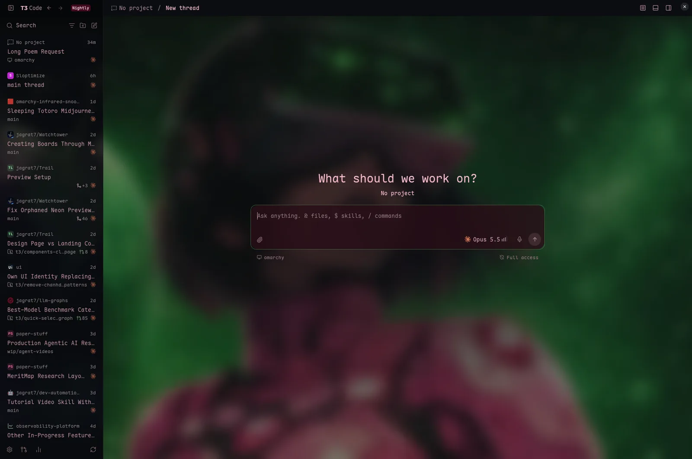
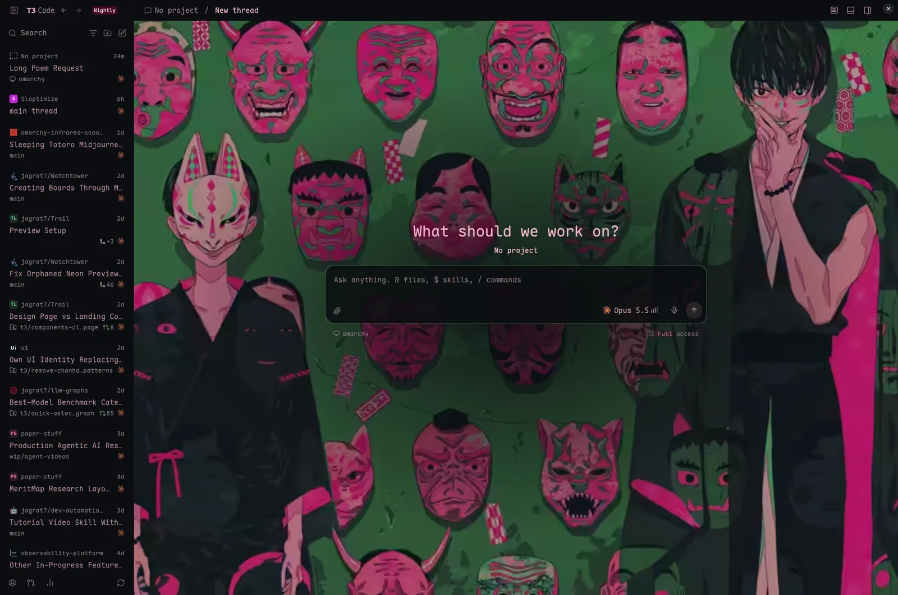

<p align="center"></p>

<h1 align="center">T3 Code Thememaxed</h1>

<p align="center">
  <a href="https://github.com/jagrat7/omarchy-t3code-thememaxed/commits/main"></a>
  <a href="https://omarchy.org/"></a>
  <a href="LICENSE"></a>
</p>

An Omarchy plugin that gives [T3 Code](https://github.com/pingdotgg/t3code) the
rest of the desktop's look, not just its colours: the system font, Hyprland's
corners and borders, the shell's menus and popups, and the theme's wallpaper
behind the app. It follows every theme switch, font change and new wallpaper
on its own.

<p align="center"></p>


## Install

```bash
omarchy plugin add https://github.com/jagrat7/omarchy-t3code-thememaxed.git --enable
```

Then in T3 Code choose **Settings > Appearance > Thememaxed**. That's all: the
plugin runs in the Omarchy shell and republishes the theme whenever the
desktop changes.



## The bar icon

Click the bar icon to pick a style.

<p></p>

**New wallpaper** swaps the picture inside T3 Code for another of the
theme's, never the one on your desktop. With `full-alt`, a slider sets the
chat column's tint. Middle-click the icon to publish again.

The icon is optional. Drag it off the bar to remove it; the theme still
follows the desktop. To bring it back:
`omarchy bar put io.github.jagrat7.omarchy-t3code-plus`.

## Styles

The wallpaper comes in three strengths, plus a sharp alternative to `full`:

| Style | Sidebar header | Conversation | Sidebar |
| --- | --- | --- | --- |
| `minimal` | Theme's first wallpaper | Plain | Plain |
| `full` (default) | Theme's first wallpaper | Random theme wallpaper | Plain |
| `max` | Theme's first wallpaper | Random theme wallpaper | Theme's first wallpaper |
| `full-alt` (not recommended) | Plain | Random theme wallpaper, sharp, behind a frosted chat column | Plain |

<table>
  <tr>
    <td><br><code>minimal</code></td>
    <td><br><code>full</code></td>
  </tr>
  <tr>
    <td><br><code>max</code></td>
    <td><br><code>full-alt</code></td>
  </tr>
</table>

On a new thread:

<table>
  <tr>
    <td><br><code>minimal</code></td>
    <td><br><code>full</code></td>
  </tr>
  <tr>
    <td><br><code>max</code></td>
    <td><br><code>full-alt</code></td>
  </tr>
</table>


Pick a style in `~/.config/omarchy-t3code-plus/config.toml`. The plugin
applies the file as soon as it is saved:

```toml
style = "full"         # minimal, full, max or full-alt
min_blur = 20          # least blur, as a Gaussian sigma in screen pixels
min_tint = 0.75        # least opacity of the theme background over the picture
backdrop_tint = "auto" # full-alt only: tint, 0 to 1, or "auto" from the wallpaper
```

Or from the bar's panel, or from a terminal, which also deals a new random wallpaper:

```bash
~/.config/omarchy/plugins/io.github.jagrat7.omarchy-t3code-plus/bin/t3code-omarchy-plus --style max
~/.config/omarchy/plugins/io.github.jagrat7.omarchy-t3code-plus/bin/t3code-omarchy-plus --tint 0.4   # or auto
```

## What changes

- **Colours.** T3 Code's stock reds, greens, blues and so on become the theme's
  terminal colours, so badges, diff counts and status text stay on theme.
  Links take the accent; selections the theme's selection colours.
- **One font.** Interface, chat, composer and code use the Omarchy system font.
- **Shape.** Corners follow Hyprland's window rounding, square included.
- **Borders.** The composer is drawn like a window: inactive border at rest,
  active border (gradient and all) while you type. Menus, dialogs and
  popovers use the shell's popup border; tooltips its tooltip border.
- **Selected rows.** The current thread and the highlighted menu item look
  like the selected row in the Omarchy menu.
- **Wallpaper.** As the style says, including on a new thread.
- **Composer row.** The machine, checkout and branch under the composer are
  plain text, without a bar behind them.

## Update and remove

```bash
omarchy plugin update io.github.jagrat7.omarchy-t3code-plus
```

```bash
omarchy plugin remove io.github.jagrat7.omarchy-t3code-plus
```

After removing it, choose any other theme in T3 Code again.

## Without the plugin

The same publisher can run from Omarchy hooks instead of the shell. Use one
or the other, not both.

```bash
git clone https://github.com/jagrat7/omarchy-t3code-thememaxed.git
bash omarchy-t3code-thememaxed/scripts/install.sh full    # or minimal, max, full-alt
```

This puts `t3code-omarchy-plus` in `~/.local/bin` and adds `theme-set` and
`font-set` hooks. Omarchy has no hook for a new wallpaper, so after
`omarchy theme bg next` run `t3code-omarchy-plus` yourself. Remove it with
`bash scripts/uninstall.sh`, which moves its files to
`~/.config/omarchy/backups/`.

## Requirements

- Omarchy 4 (Quattro), which publishes T3 Code's palette
  (`omarchy-theme-set-t3code`) and resolves theme colours
  (`omarchy-theme-color`).
- T3 Code nightly 0.1.10 from 15 November 2026 or newer, which takes 50,000
  characters of theme CSS.
- Python 3.11 or newer, which Omarchy ships.
- ImageMagick with AVIF support, which Omarchy ships. If you removed it,
  `omarchy pkg add imagemagick libheif` brings the wallpaper back.
- Optional: `avifenc` (`libavif`) for sharper wallpapers.

Tested with Omarchy 4.5 and T3 Code 0.1.10 (nightly, November 2026).

## Limits

- T3 Code takes at most 50,000 characters of theme CSS, pictures included. The
  publisher shrinks the wallpapers to fit and leaves them out, then the CSS,
  rather than publish a theme T3 Code would reject.
- Syntax colours in T3 Code's file viewer and diffs can't be themed: they are
  drawn in shadow DOM with a fixed scheme that theme CSS cannot reach.
- The CSS uses T3 Code's documented `data-*` selectors. The square-corner
  rules also match Tailwind class names, which a T3 Code update may rename.
- T3 Code marks no new-thread state. The publisher spots it by the composer
  filling the conversation (its `inset-0` class) and lets the wallpaper
  through the empty timeline's placeholder (`data-timeline-loading`). If an
  update renames either, a new thread looks like any other thread.

### Misc
independent project, not affiliated with Omarchy or T3 Code.
